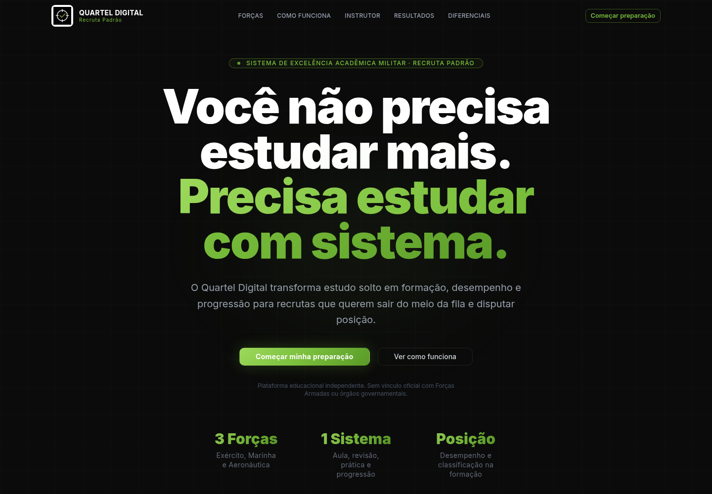
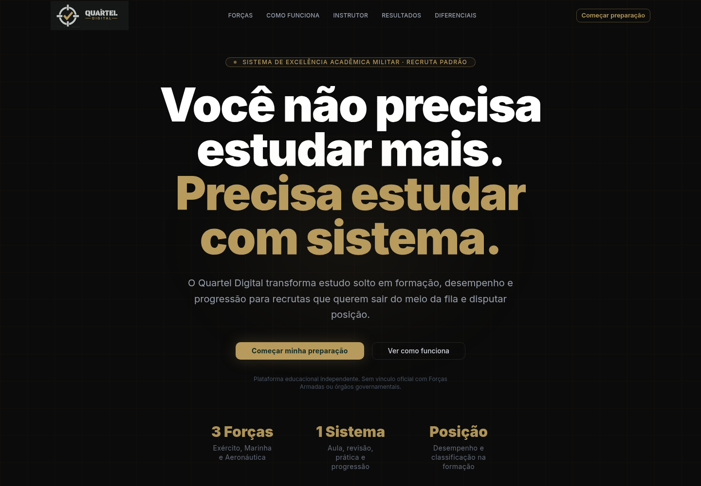
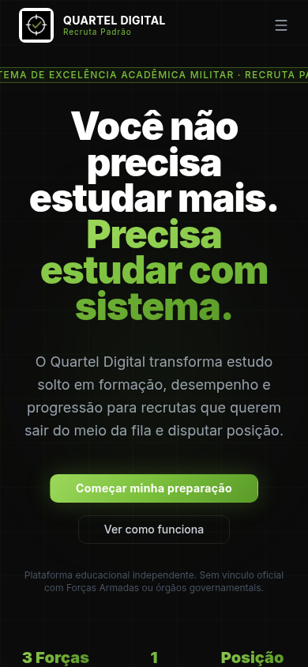
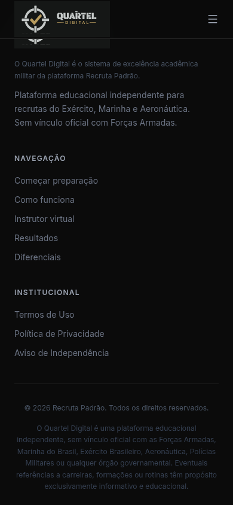
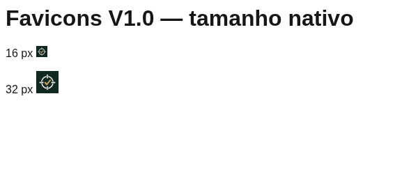

# Issue #13 — auditoria e aplicação Quartel Digital V1.0

Branch: `codex/quartel-digital-brand-v1-audit`. Base: `9b80070c91ac7d7e9ad514fc5bb007efef59d964`.
Escopo: site institucional; sem merge, deploy, alterações em produção ou identidades de outros produtos.

## Fonte e preservação

Fonte única: ZIP enviado pelo responsável nesta conversa, `Quartel_Digital_V1_Pacote_Consolidado_Favicons_Corrigidos.zip` (1.253.658 bytes).
SHA-256: `e0414884cf17c60a80ac4b8cb7bcb38389fbe1d3db68f5f5d61dda5352591eb8`.
CRC íntegro; 44 arquivos: 12 SVGs, 12 PNGs de logos, 14 itens de favicons e 6 relatórios/prévias.
O ZIP e os 44 originais estão arquivados neste diretório, fora de `public`, sem alteração de bytes. `SHA256SUMS.json` registra cada original. Não editar esses arquivos: qualquer nova versão deve ter outro diretório e outro registro de origem.

As cópias de aplicação em `public/assets/brand/quartel-digital-v1/` e `src/app/favicon.ico` são byte a byte iguais às entradas do ZIP. Nenhuma derivação, redesenho, filtro CSS, recorte ou recoloração dos logos foi necessária. A proporção horizontal 2400:900 foi mantida.

## Inventário e decisões

| Ponto | Antes | Alteração automatizada |
| --- | --- | --- |
| Framework/build | Next.js 16.2.4, React 19.2.4, TypeScript, Tailwind v4; README dizia Next 15 | README corrigido; dependências/lockfile preservados |
| Navbar e Footer | `logoqd.png` quadrado + nome composto em HTML | Assinatura completa `QD_12_horizontal_grafite.svg` pronta para fundo escuro; sem reconstrução tipográfica |
| `src/app/globals.css` | Acento lima `#7ABF3C`, gradiente | Dourado sólido `#B89B5E` e cinza `#C4C8C7` extraídos dos SVGs; sem inventar gradiente |
| Seções institucionais | Acentos lima explícitos | Acentos e brilhos correspondentes atualizados; botões dourados com texto verde `#102820` para contraste |
| `src/app/favicon.ico` | Ícone legado, sem rastreabilidade V1.0 | ICO corrigido do ZIP, com 16/32/48/64/128/256 px |
| `src/app/layout.tsx` | Sem configuração explícita dos ícones V1.0 | SVG, PNG 16/32 e Apple 180 do pacote |
| `src/app/manifest.ts` | Ausente | Manifest com ícones 192/512 e cores do pacote; `display: browser`, sem prometer PWA offline |
| Rastreabilidade | Ausente | Arquivo ZIP, originais, hashes e `scripts/verify-brand.py` |
| Evidências | Ausentes | Capturas antes/depois desktop/mobile, verificação de navegador e logs |

Os arquivos exatos alterados constam no diff da PR. Navbar/Footer são os únicos consumidores dos logos antigos encontrados no código antes da alteração. Os três arquivos legados em `public/assets/logo/` permanecem históricos, mas não são referenciados pela interface atual. Os arquivos SVG genéricos do scaffold também não são utilizados como marca.

Inter/Geist continuam sendo fontes da interface, não da assinatura da marca, cuja tipografia vem vetorizada no SVG aprovado. O ZIP não fornece fonte ou manual de tipografia da interface. Fundos neutros e cores semânticas não foram redefinidos. As cores próprias das Forças em `EscolhaSuaForca.tsx` foram preservadas.

## Pipeline, WordPress e dependências

Scripts disponíveis: `dev`, `lint`, `build`, `start`; não havia script de teste automatizado. Não há `.github/workflows`, configuração de deploy versionada, código PHP, WordPress ou Elementor neste checkout. Não há tarefa que dependa de painel WordPress neste repositório. Configurações externas de hospedagem e outros repositórios não foram auditados. Nenhum serviço externo foi atualizado; servidores usados nos testes são locais ao ambiente.

## Diferenças geométricas e limites

Os relatórios originais do próprio ZIP descrevem diferenças sutis de contorno, cor e antialiasing em relação à V6 anterior. `RELATORIO_CORRECAO.txt` registra escalas de enquadramento de 0,9174 (verticais), 1,0386 (horizontais) e 0,9597–0,9611 (símbolos), sem afirmar equivalência geométrica. Essas são observações do fornecedor do pacote, não medições independentes desta execução: a matriz V6 de comparação não foi disponibilizada separadamente.

A presente solicitação autoriza o pacote V1.0 enviado como fonte. Os relatos históricos de pendência foram preservados literalmente nos originais, sem serem tratados como instruções que substituam a autorização do responsável. Não foi feita correção geométrica adicional nem declaração de equivalência absoluta à V6.

Os favicons corrigidos preservam mira circular, quatro marcadores retangulares e check dourado. Em 16 px há perda natural de detalhe. Os dez PNGs de favicon têm dimensões nominais corretas e canal alfa totalmente opaco (255): o fundo verde é parte do arquivo aprovado. As cinco versões de logo PNG declaradas transparentes (03/04/05/08/10) têm alfa entre 0 e 255. A variante horizontal grafite escolhida tem fundo opaco por definição. Transparência não foi adicionada artificialmente.

Riscos preexistentes fora desta aplicação: links institucionais com `href="#"`, navegação para `#diferenciais` sem seção montada e textos de baixo contraste em partes da interface. Não foi feita uma revisão completa de acessibilidade ou de conteúdo. O pacote não contém manual para ampliar a alteração à tipografia de toda a interface.

## Validação executada

- `npm ci --no-audit --no-fund --cache /workspace/work/npm-cache`: sucesso, sem alteração do lockfile. Cache local necessário porque o diretório padrão do npm não é gravável no sandbox.
- `npm run lint`: passou antes e depois.
- `npx tsc --noEmit`: passou; build também executou TypeScript após as alterações finais.
- `npm run build`: passou, gerando `/`, `/_not-found` e `/manifest.webmanifest`.
- `python scripts/verify-brand.py`: passou; CRC, inventário de 44 arquivos, hashes dos originais e cópias implantáveis.
- Chromium/Playwright contra `next start` local: 1440×1000, 768×1024, 390×844 e 320×720; sem overflow horizontal ou erros JavaScript; ambos os logos carregados; dourado computado correto; menu mobile abre e fecha ao navegar.
- Manifest, ICO, SVG e PNGs 16/32/180/192/512: HTTP 200, MIME correto. Cache de assets públicos `public, max-age=0`; ICO e manifest revalidam (`public, max-age=0, must-revalidate`). URLs públicas incluem versão; ICO recebe query de conteúdo do Next. Nenhum service worker foi adicionado. Cache da aba/OS ainda deve ser verificado no dispositivo de homologação.
- Capturas do estado anterior foram obtidas no checkout separado da base; capturas finais no build de produção local. Veja `evidence/` e `browser-results.json`. `visual-check.cjs` registra o procedimento executado (requer Playwright e Chromium; caminhos do ambiente estão explícitos).

## Homologação sem deploy

1. Executar `npm ci`, `python scripts/verify-brand.py`, `npm run lint`, `npm run build` e `npm start` no checkout da branch.
2. Comparar as capturas abaixo e validar assinatura no cabeçalho/rodapé em desktop e mobile, inclusive menu e rolagem.
3. Abrir favicon PNG em tamanho nativo 16 e 32 px e confirmar visualmente os detalhes disponíveis; comparar com os arquivos originais, não com uma reconstrução.
4. Conferir aba do navegador, favoritos e ícone Apple, com nova sessão e recarga sem cache. Instalação/ícones do sistema operacional exigem verificação humana no dispositivo real; não foram simulados como aprovados.
5. Registrar qualquer divergência separadamente. Mudanças de geometria exigem novo asset aprovado. Esta PR permanece draft para revisão; merge e publicação não fazem parte desta execução.

### Antes/depois

| Antes | Depois |
| --- | --- |
|  |  |
|  |  |
|  |  |

